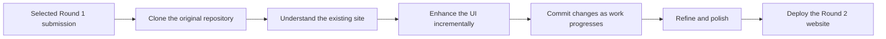
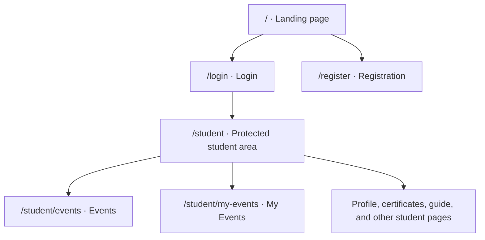

# <div align="center">CAMPUSCODE</div>

<div align="center">

### Dashboard Recreation · Hackathon Round 2

**Build. Compete. Ship.** A student-focused platform, refined for the next round.

<br />


</div>

---

<div align="center">

## Round 1 selected · Qualified for Round 2

CampusCode’s Round 1 submission was selected to advance. This Round 2 project continues that work: the original site was the foundation, and its interface was improved incrementally rather than replaced with an unrelated, from-scratch product.

</div>

---

## Live Demo

<div align="center">

[](https://campuscode-redesigned.vercel.app/)

**[campuscode-redesigned.vercel.app](https://campuscode-redesigned.vercel.app/)**

</div>

## Project Demo Video

The Round 2 demo video will be added here when it is ready.

<!-- Add your Round 2 demo video link here. -->
<!-- Replace this section with your GitHub-hosted Round 2 video attachment URL. Do not use the Round 1 demo. -->

---

## About CampusCode

CampusCode is a student-focused platform interface for discovering campus opportunities and managing a student activity dashboard. The website brings together a landing page, student registration and login, an overview dashboard, event discovery, and a personal events area, alongside additional student workspace pages.

Round 2 builds on the selected Round 1 implementation. Its focus is a more cohesive visual experience—more considered typography and spacing, polished components, motion, and interactive details—while retaining the CampusCode identity and the existing product flow.

> **Scope note:** This is a frontend project. The current authentication flow is a browser-local demo implementation using `localStorage`; it is not connected to a production authentication backend.

## How Round 2 Evolved from Round 1

This submission was developed as an enhancement of the Round 1 website, not as a separate project created from scratch.

1. **Cloned the Round 1 repository.** The original submission provided the foundation for the next round.
2. **Studied the existing implementation.** The component structure, styles, layouts, and interactions were reviewed before changes were introduced.
3. **Enhanced the UI incrementally.** The existing experience was refined with updated layouts and visual hierarchy, motion, hover feedback, improved buttons, and other interaction details—while preserving its identity and structure.
4. **Committed work throughout development.** Changes were recorded in incremental Git commits rather than left as one large final change.
5. **Made final refinements.** After the larger improvements, additional polish was applied to the interface and interactions.
6. **Deployed the updated website.** The completed Round 2 experience was deployed to Vercel.



### Previous Submission — Round 1

Round 2 continues the work of the selected Round 1 submission. This is the **original Round 1 repository**, not the current Round 2 repository:

[](https://github.com/Shambhavichaudhary/CampusCode-Recreation)

**[github.com/Shambhavichaudhary/CampusCode-Recreation](https://github.com/Shambhavichaudhary/CampusCode-Recreation)**

## Round 2 Objective

The objective was to enhance the existing Round 1 website rather than discard it or replace it with a completely new product. The work focused on making the platform feel more considered and consistent across its pages:

- Modernizing the visual design while retaining CampusCode branding.
- Improving typography, spacing, hierarchy, and component presentation.
- Adding smooth motion and page transitions.
- Refining hover states, buttons, and smaller interaction feedback.
- Bringing the landing, authentication, and student areas into a more cohesive visual system.
- Preserving the existing student-facing flows while improving their overall experience.

## Website Sections

### Landing Page

The landing page introduces CampusCode with a prominent “Build. Compete. Ship.” hero, navigation, calls to action, and sections describing the platform, its process, events, and community. Animated background details and visual accents support the page’s visual storytelling.

### Registration

The registration page presents a dedicated student sign-up experience with styled form fields, password visibility controls, a refreshable CAPTCHA, and animated background details. The current demo stores registrations in the browser.

### Login

The login page carries the CampusCode identity into the authentication flow. It includes styled fields, a password visibility interaction, a refreshable CAPTCHA, and animated feedback during a successful demo login.

### Student Dashboard

The student area includes an overview dashboard with widgets for welcome information, featured and upcoming events, tasks, progress, calendar, and other student activity. Students can customize the dashboard layout and widget visibility; preferences are stored in browser `localStorage`.

### Events

The events area provides a browsable catalogue with event details and actions such as joining or saving events. The displayed event catalogue is frontend data.

### My Events

The My Events page groups a student’s event activity into registered, ongoing, completed, and wishlist views, with search, event details, and relevant event actions.

### Additional Student Pages

The student navigation also includes pages for profile, certificates, digital card, guidance, notifications, help, and other student tools. These are frontend experiences and should not be interpreted as integrations with external services.

### Application Routes



## Motion and Interactions

Motion and interaction details present in the source include:

- **Page transitions:** Framer Motion fades between routes; the student area keeps its shared shell while student pages change.
- **Landing visuals:** CSS-driven movement for the hero’s background accents, decorative orbs, and floating elements.
- **Authentication backgrounds:** animated floating dots on the login and registration pages.
- **Pointer detail:** a decorative cursor glow is rendered across the application.
- **Interaction feedback:** hover lift and pressed states on selected buttons and navigation elements.
- **Reduced-motion support:** decorative animations and hover movement are disabled when the user requests reduced motion.
- **Form interactions:** password visibility toggles and refreshable CAPTCHA challenges.

The implementation uses CSS animations and Framer Motion. Scroll-triggered reveal animations are not listed here because they are not established by the inspected source.

## Technologies

<div align="center">


</div>

| Technology | Role |
|---|---|
| React | Component-based user interface |
| Vite | Development server and production build |
| JavaScript (ES modules) | Application logic |
| React Router | Client-side page routing |
| Framer Motion | Route transition animation |
| CSS | Page layouts, visual styles, and CSS animations |
| Git and GitHub | Version control and repository hosting |
| Vercel | Live website deployment |

**Styling accuracy:** The checked-in `package.json` does not include Tailwind CSS. The current implementation’s page styles are provided by CSS files under `src/styles/`.

## Run Locally

### Prerequisites

- Node.js (current LTS recommended)
- npm
- Git

### Clone the Round 2 Repository

Replace the placeholder below with the URL of this Round 2 repository. The Round 1 repository link above is not the clone URL for this project.

```bash
git clone <ROUND_2_REPOSITORY_URL>
cd <ROUND_2_REPOSITORY_DIRECTORY>
```

### Install Dependencies

```bash
npm install
```

### Start the Development Server

```bash
npm run dev
```

Vite prints the local development URL in the terminal.

### Build for Production

```bash
npm run build
```

### Run the Linter

```bash
npm run lint
```

### Preview the Production Build

After building, start Vite’s local preview server with:

```bash
npm run preview
```

## Project Structure

This compact tree shows the main checked-in application structure; `...` marks additional files in that directory. Generated and installed directories such as `dist/` and `node_modules/` are intentionally omitted.

```text
.
├── .gitignore
├── .oxlintrc.json
├── index.html
├── package.json
├── package-lock.json
├── vite.config.js
└── src/
    ├── App.jsx
    ├── main.jsx
    ├── assets/
    │   └── CampusCode_Showcase.mp4
    ├── components/
    │   ├── auth/          # AuthFrame.jsx, AuthFields.jsx, ProtectedRoute.jsx, ...
    │   ├── common/        # BrandLogo.jsx, ...
    │   ├── events/        # EventBanner.jsx, EventDetailsModal.jsx, ...
    │   ├── landing/       # Hero.jsx, Navbar.jsx, page sections, ...
    │   ├── motion/        # CursorGlow.jsx
    │   └── student/       # StudentShell.jsx, Sidebar.jsx, WidgetBoard.jsx, ...
    ├── context/
    │   └── StudentUIContext.jsx
    ├── data/
    │   ├── dashboardConfig.js
    │   ├── eventsData.js
    │   └── studentPagesData.js
    ├── hooks/
    │   ├── useDashboardPrefs.js
    │   ├── useDocumentTitle.js
    │   ├── useEventStore.js
    │   └── usePageStyles.js
    ├── pages/
    │   ├── Dashboard/Dashboard.jsx
    │   ├── Events/Events.jsx
    │   ├── Login/Login.jsx
    │   ├── MyEvents/MyEvents.jsx
    │   ├── Register/Register.jsx
    │   ├── StudentDashboard/StudentDashboard.jsx
    │   └── student/        # Profile, certificates, guide, and other student pages
    │       └── ...
    ├── styles/
    │   ├── animations.css
    │   ├── pages/         # Landing, authentication, events, and student page styles
    │   └── shared/        # Shared authentication, branding, and student styles
    └── utils/
        └── auth.js
```

`src/App.jsx` defines the application routes and page transitions. `src/main.jsx` mounts the React application and router. Page-specific React components live in `src/pages/` and reusable UI in `src/components/`; static application data, hooks, and browser-local demo authentication are separated into `data/`, `hooks/`, and `utils/`. Styles are grouped by page and shared UI in `src/styles/`.

## Screenshots

Screenshots are not included yet. Add your own Round 2 screenshots in the marked locations when they are ready.

<div align="center">

### Landing Page
<!-- Add Landing Page screenshot here -->
<!-- Example:  -->

### Login Page
<!-- Add Login Page screenshot here -->

### Registration Page
<!-- Add Registration Page screenshot here -->

### Student Dashboard
<!-- Add Student Dashboard screenshot here -->

### Events
<!-- Add Events screenshot here -->

### My Events
<!-- Add My Events screenshot here -->

</div>

## Development Highlights

- **Selected for Round 2:** the Round 1 submission qualified for the next stage.
- **Built on the original:** the existing CampusCode experience remained the foundation.
- **Improved in increments:** visual refinements and interaction details were added over the course of development.
- **Refined across pages:** landing, authentication, dashboard, and event experiences share a more considered visual direction.
- **Committed along the way:** development was recorded through incremental Git commits.
- **Deployed:** the Round 2 website is live on Vercel.

## Author

**Shambhavi Chaudhary**

[](https://github.com/Shambhavichaudhary)

---

<div align="center">

**CAMPUSCODE · BUILD. COMPETE. SHIP.**

</div>